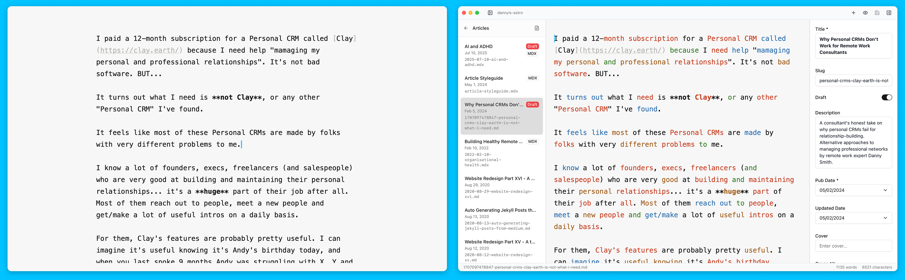

# Astro Editor



A native macOS markdown editor for Astro content collections. Clean writing interface with automatic frontmatter editing based on your collection schemas.

https://github.com/user-attachments/assets/e7358217-d876-4b45-befb-d6cd22f52b49

## Features

**Writing Environment**

- Clean markdown/MDX editor with syntax highlighting. Frontmatter and imports are hidden while editing, shown in a dedicated sidebar.
- Focus mode (highlights current sentence), copyedit mode (highlights parts of speech), and typewriter mode (keeps the cursor centered on screen).
- Customizable heading colors with separate settings for dark and light themes.
- Image preview on hover (Option + hover over paths).
- Comprehensive keyboard shortcuts for formatting, headings, and navigation.
- Auto-save: saves 2 seconds after you stop typing (configurable) with backup saves every 10 seconds while typing, and before the app quits. Crash recovery included.

**Frontmatter & Schema Integration**

- Generates editing forms from your Astro collection schemas with proper validation.
- Supports all Zod types: strings, numbers, dates, booleans, enums, arrays, nested objects, references, and image fields.
- Image fields provide drag-and-drop with automatic copying to your assets directory using relative paths by default (configurable per project/collection).
- Field constraints (min/max, character limits) enforced in the UI.

**MDX Components**

- `Cmd + /` opens the component builder, listing the components in your MDX components folders (`src/components/mdx/` by default), plus Starlight's own components in Starlight projects.
- Pick one and fill in a form for its props, built from their types, with image and collection entry pickers. Supports Astro, React, Vue, and Svelte components.
- Optionally adds the component's import to the file for you (experimental).

**File Management**

- Collections read from your `content.config.ts`, with each collection's folder and file pattern taken from its loader, so content can live anywhere in the project.
- Full support for subdirectories within collections.
- Files sorted by publication date (configurable field name) with draft indicators.
- New files named by a pattern per collection: the date, the title, or both.
- Context menu for rename, duplicate, reveal in Finder, copy path.
- Command palette (`Cmd + P`) for quick file switching and command access.
- Project list (`Cmd + Shift + O`) for switching between projects and finding ones you've moved.

**Project Settings**

- Shows what Astro Editor found in your project (each collection's folder, frontmatter fields and schema) and flags anything it couldn't work out.
- Change only what it got wrong: collection folders, field mappings (title, date, draft, description), file names, image folders and more.
- Light/dark theme with system integration.
- IDE integration (open files/projects in VSCode, Cursor, etc.).

## Supported Astro Projects

- **Astro Version**: 5, 6 or 7 (may work with 4.x but expect bugs)
- **Content Collections**: Markdown or MDX collections defined with `defineCollection`, ideally with the `glob` loader and a schema
- **Configuration**: Requires `src/content.config.ts` or the older `src/content/config.ts`. A custom `srcDir` isn't supported.

Non-markdown/MDX files in collections are ignored.

Default directory structure. Collections can live wherever their loader says, and the other paths can be changed in Project Settings:

```
my-astro-site
└── src
    ├── assets/mycollection/      # Images and media
    ├── components/mdx/            # Astro/React/Vue/Svelte components for MDX
    ├── content/mycollection/      # Markdown and MDX files
    └── content.config.ts          # Collection definitions
```

## Installation

Requires macOS 12 or later. Download the [latest Release](https://github.com/dannysmith/astro-editor/releases) or install with Homebrew:

```
brew install --cask astro-editor
```

**Other Platforms:** Windows (.msi) and Linux (.AppImage, .deb, .rpm) builds are available from the releases page but are not officially supported yet. Use at your own risk.

## Documentation

- **[Documentation](https://astroeditor.danny.is/getting-started/)** - Complete feature documentation
- **[Contributing](docs/CONTRIBUTING.md)** - Development setup and guidelines

## Disclaimer

Work in progress. Commit your Astro project regularly when using the editor.

## Contributing

Bug reports and feature requests are welcome. See the [issue tracker](https://github.com/dannysmith/astro-editor/issues).

**Project Philosophy:**

- This is a tool for "writer mode", not "coder mode". Features related to git, publishing, deployment, or code editing are out of scope.
- The UI is intentionally opinionated for simplicity. Customization options are limited to what's needed to work with different Astro project structures.

Pull requests welcome. See [CONTRIBUTING.md](docs/CONTRIBUTING.md) for development setup.

## Roadmap

See the [GitHub Project](https://github.com/users/dannysmith/projects/5/)

## Credits

- [iA Writer](https://ia.net/writer) for inspiration and [typography](https://github.com/iaolo/iA-Fonts)
- [DarkMatter](https://getdarkmatter.dev/) by [Vadim Demedes](https://vadimdemedes.com/)

## Development

See [CONTRIBUTING.md](docs/CONTRIBUTING.md) and [developer docs](docs/developer/) for setup and architecture details.

**Quick start:**

```bash
bun run setup       # Installs dependencies and creates a test Astro project
bun run tauri:dev   # Starts dev server
```

**A new worktree** (each runs its own dev app; see [CONTRIBUTING.md](docs/CONTRIBUTING.md#working-on-several-things-at-once)):

```bash
wt switch -c my-branch -x claude   # Creates ../astro-editor.my-branch, sets it up and starts Claude
bun run tauri:dev                  # In another terminal in that worktree
wt remove my-branch                # Once its PR has merged
```

**Development commands:**

```bash
bun run check:all       # Run all checks (TypeScript, Rust, tests)
bun run fix:all         # Auto-fix linting/formatting issues
```
