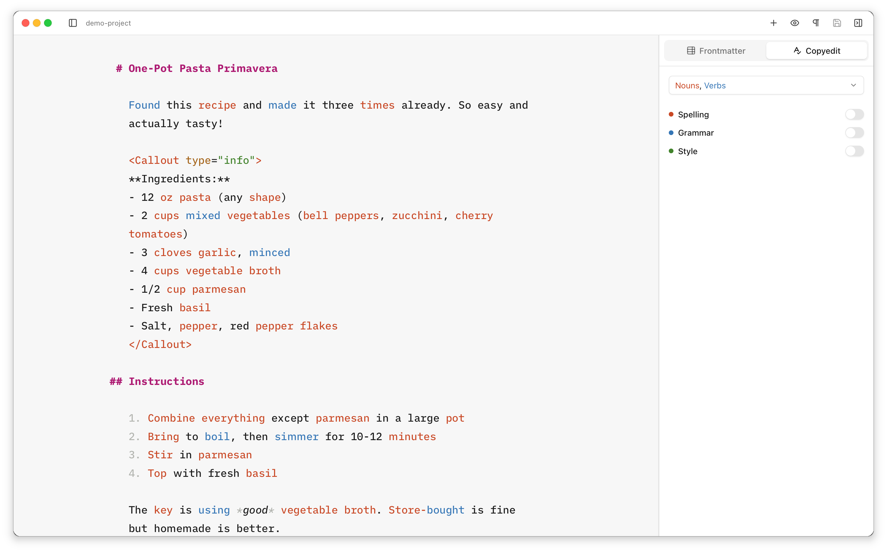
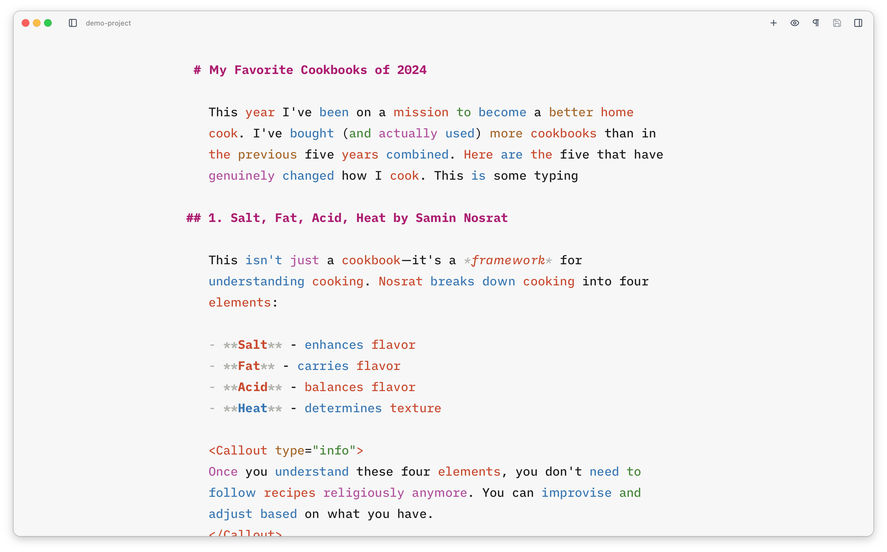
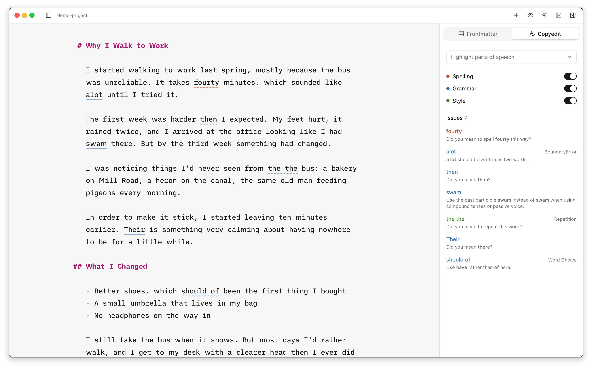
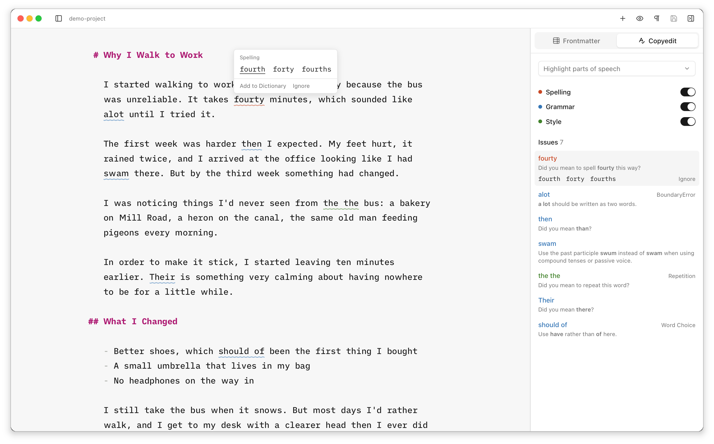

Where [Focus and Typewriter modes](/editor/focus-and-typewriter/) are designed to help with writing, the **copyedit** features help with editing and tweaking your work. They live in the **Copyedit** tab of the right sidebar, which you can open with <Kbd mac="Cmd+3" windows="Ctrl+3" />.

## Highlighting Parts of Speech

You can highlight the different parts of speech in your text, each in its own colour.

| Part of speech   | Colour | Why you might want it                          |
| ---------------- | ------ | ---------------------------------------------- |
| **Nouns**        | Red    | Identify the subjects and objects in your text |
| **Verbs**        | Blue   | Spot action words and check tense patterns     |
| **Adjectives**   | Brown  | Review how much descriptive language you use   |
| **Adverbs**      | Pink   | Catch potentially unnecessary modifiers        |
| **Conjunctions** | Green  | See how your sentences are connected           |

Pick the ones you want from the dropdown at the top of the Copyedit panel, which names the highlights that are on and has **Show All** and **Hide All**. You can also switch them individually or all together from the [command palette](/reference/commands/#copyedit).

## Spelling, Grammar and Style

Switch on **Spelling**, **Grammar** and **Style** in the Copyedit panel. Issues are underlined in the editor, in red for spelling, blue for grammar and green for style, and listed in the panel in the order they appear in your file.

The checks use [Harper](https://writewithharper.com), which is built into Astro Editor and **runs entirely on your computer**, so nothing you write is sent anywhere. It loads the first time a check runs, so you'll see a short "Starting checks…" pause. It only checks English. You can choose American, British, Canadian, Australian or Indian English in [Preferences](/preferences/#copyedit).

### Fixing an Issue

Hover over an underline, or click an issue in the panel, to see what Harper suggests.

- **Click a suggestion** to apply it.
- **Add to Dictionary** (spelling only) tells the spelling check the word is fine. You can edit your dictionary in [Preferences](/preferences/#copyedit).
- **Ignore** hides the issue wherever the same words appear, in any file. **Clear Ignored Issues** in Preferences brings them all back.

### What Gets Checked

Harper checks your prose, including the text of links and the text inside components. It doesn't check:

- Your frontmatter
- Code, inline or in blocks
- URLs and images
- HTML and component tags
- MDX imports and `{expressions}`
- Paths and file names

### What It Leaves Alone

The checks are deliberately quiet, so they'll miss some mistakes rather than nag you about things that are fine. They don't flag:

- **Names and acronyms:** capitalised words inside a sentence, and things like `MDX` or `APIs`.
- **Words that look like code**, like `pubDate`, `v1` or `max_width`.
- **House-style choices**, like the Oxford comma, "config" instead of "configuration", or "gonna".
- **Lowercase list items and table cells**, which are usually a choice.
- **Common Astro words**, like "frontmatter".
