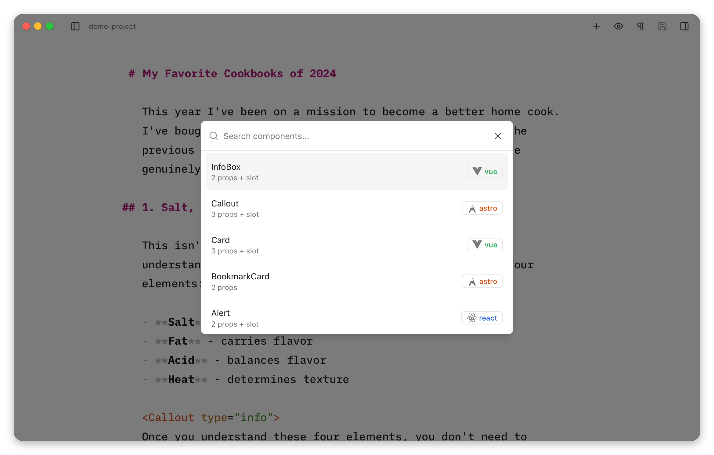
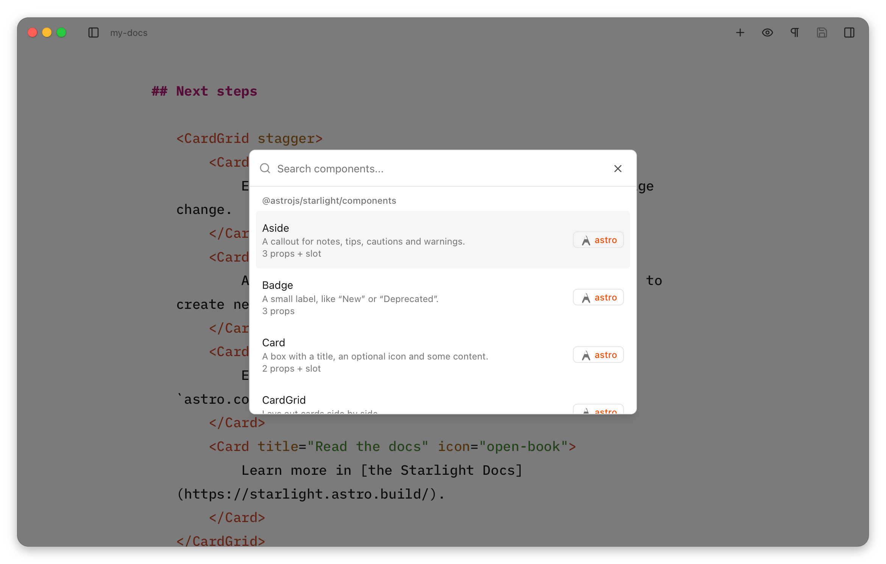
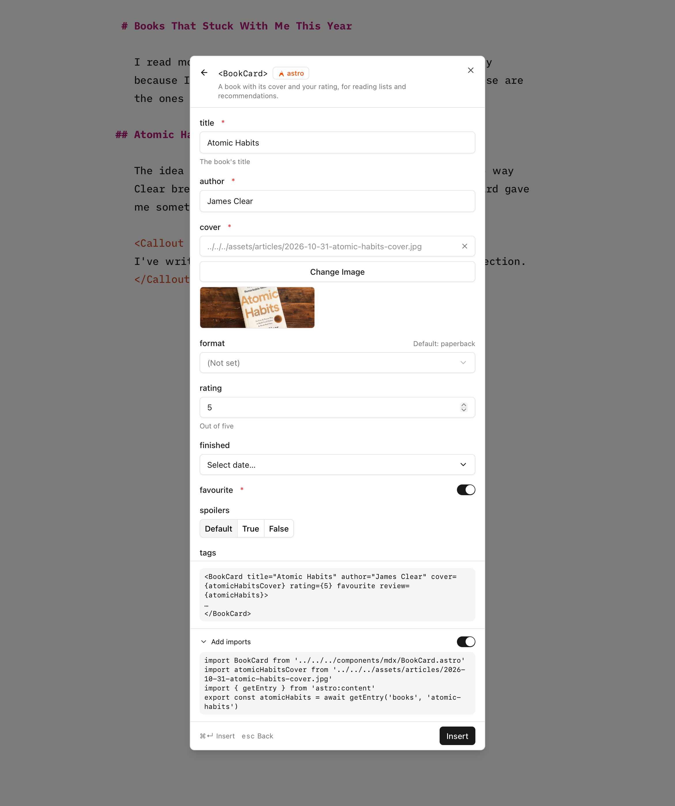

import { Badge } from '@astrojs/starlight/components'

Many Astro sites contain components which are specifically designed for use in MDX content files. Here's a simple example.

```astro title="Highlight.astro"
<span class="highlight"><slot /></span>

<style>
  .highlight {
    background: var(--color-highlight-bg);
    padding: 0 8px 4px;
  }
</style>
```

Which we might use like this.

```mdx title="my-post.mdx"
This is some <Highlight>text I wanna highlight</Highlight>.
```

We can probably remember how to use a simple component like this, but components which take several props often mean opening a code editor and reading the component before we can use it.

## The MDX Component Builder

Astro Editor helps by giving you an interface for finding components and inserting them into MDX files. When editing an MDX file, <Kbd mac="Cmd+/" windows="Ctrl+/" /> opens a palette showing all the components in your *MDX directory*, and you filter them by typing.



Each entry shows its framework as a coloured badge, which props it requires (or how many optional ones it has) and whether it wraps content. If the component has a doc comment, its first lines are shown under the name. Your own components come first, followed by any from packages, like [Starlight's](#starlights-components), under the module they're imported from.

<Kbd mac="Enter" windows="Enter" /> opens a form with a field for each of the component's props and a preview of the tag that will be inserted. <Kbd mac="Cmd+Enter" windows="Ctrl+Enter" /> inserts it, with your cursor in the first required prop you left empty, or inside the component if it wraps content. <Kbd mac="Tab" windows="Tab" /> moves between those spots afterwards, and <Kbd mac="Esc" windows="Esc" /> takes you back to the list.

## An Example Component

Here's a component that uses most of what the builder understands.

```astro title="src/components/mdx/BookCard.astro"
---
/**
 * A book with its cover and your rating, for reading lists and recommendations.
 */
import { Image } from 'astro:assets'
import type { ImageMetadata } from 'astro'
import type { CollectionEntry } from 'astro:content'

interface Props {
  /** The book's title */
  title: string
  author: string
  cover: ImageMetadata
  format?: 'hardback' | 'paperback' | 'ebook' | 'audiobook'
  /** Out of five */
  rating?: number
  finished?: Date
  favourite: boolean
  spoilers?: boolean
  tags?: string[]
  /** Your full review, linked from the card */
  review?: CollectionEntry<'books'>
}

const { title, author, cover, format = 'paperback', rating, finished, favourite, review } =
  Astro.props
---

<article class:list={['book-card', { favourite }]}>
  <Image src={cover} alt={`The cover of ${title}`} width={160} />
  <h3>{title}</h3>
  <p>{author} · {format}{rating && ` · ${rating}/5`}</p>
  <slot />
  {review && <a href={`/books/${review.id}`}>Read my review</a>}
</article>
```

And here's the form the builder shows for it.


A few things to notice:

- **Required props are marked with an asterisk.** A prop is required unless it's optional (`format?:`). Leave a required prop empty and the builder inserts it with your cursor in it, ready to fill in.
- **Optional props are left out unless you give them a value**, so the component's own defaults apply.
- **Defaults are shown beside the prop's name.** They come from destructuring `Astro.props` (`format = 'paperback'`). React parameters, Vue's `withDefaults` and Svelte's `$props()` work the same way.
- **Doc comments become help text.** A comment on a prop appears under its field, and one at the top of the component is its description in the list and the form.
- **A component with a `<slot />` wraps content.** Inserted on an empty line, it goes in on lines of its own, with blank lines around the content so you can write markdown inside it.
- **`cover` and `review` get pickers** here because [Adding Imports](#adding-imports) is turned on for this project. Without it, they're text boxes for the name of something you've imported or loaded yourself.

## How Props Become Fields

| Prop type | Field | Inserted as |
| --- | --- | --- |
| `string` | A text box that grows as you type | `title="Atomic Habits"` |
| A union of strings (`'ebook' \| 'paperback'`), or a string enum | A dropdown, which you can search when there are more than 12 options | `format="ebook"` |
| `number` | A number field | `rating={5}` |
| `boolean`, required | A switch | `favourite` or `favourite={false}` |
| `boolean`, optional | Default, True or False, where Default leaves it out | `spoilers` |
| `Date` | A date picker | `finished={new Date('2026-01-15')}` |
| `string[]` or `number[]` | A list you add items to | `tags={['habits', 'productivity']}` |
| An array of a union of strings | A dropdown you can pick several from | `formats={['ebook']}` |
| `ImageMetadata` | A text box for the name of an imported image, or an [image picker](#images) | `cover={atomicHabitsCover}` |
| `CollectionEntry<'books'>` | A text box for the name of a loaded entry, or an [entry picker](#collection-entries) | `review={atomicHabits}` |
| Anything else | A text box | The text, as a string |

Text containing quotes or line breaks is written as a template literal (``note={`Say "hi"`}``) so it survives MDX.

For components written in a framework (React, Vue or Svelte), the form also has a [client directive](https://docs.astro.build/en/reference/directives-reference/#client-directives) — `client:load`, `client:idle`, `client:visible`, `client:media` or `client:only`. This controls when (and whether) Astro hydrates the component in the browser, and gets added to the inserted tag. `client:idle` is a good choice for most cases. Astro components don't need one, so the option only appears for framework components.

## How Props Are Read

Astro Editor reads your components' source code. It doesn't run your project or a type checker, so it works without installing anything, but it can only follow types it can see.

Each framework declares its props differently:

- **Astro:** an `interface Props` or `type Props` in the component's frontmatter
- **React:** the type of the component's first parameter, or `FC<Props>`
- **Vue:** `defineProps` in `<script setup>`, typed or with runtime declarations
- **Svelte:** `export let` or `$props()`

A component takes content if it has a `<slot>` (Astro, Vue and Svelte) or a `children` prop (React and Svelte).

To work out what a prop accepts, Astro Editor follows:

- interfaces, type aliases and string enums in the same file
- `(typeof FORMATS)[number]` and `keyof typeof SIZES`
- `extends` and intersections of those types
- types imported by a relative path (`'./types'`) from `.ts` and `.d.ts` files in your project

It doesn't follow tsconfig aliases (`'@/types'`) or types from packages. Props inherited from types it can't see, like `HTMLAttributes<'a'>`, are left out, which is usually what you want in a writing tool. A prop whose type it can't work out gets a text box, and a component whose code it can't parse is still listed, with no props.

If a field isn't what you expect, define the prop's type in the component itself or import it with a relative path.

## Starlight's Components

If your site uses [Starlight](https://starlight.astro.build/), the builder also lists Starlight's [built-in components](https://starlight.astro.build/components/using-components/), like `Aside`, `Tabs`, `Card` and `Steps`. Astro Editor treats a project as a Starlight site when `@astrojs/starlight` is in the `dependencies` or `devDependencies` of its `package.json`.



Components that wrap other content come with it filled in: `Tabs` gives you two `TabItem`s ready to label, `CardGrid` gives you `Card`s, `Steps` a numbered list and `FileTree` an example tree.

Starlight's components aren't read from your project's `node_modules`. Astro Editor comes with a description of them, currently made from Starlight 0.42, so if your site uses a much older or newer version, a prop might be missing or different.

If your project has its own component with the same name as one of Starlight's (a `Card`, say), both are listed, under different headings.

## Adding Imports

<Badge text="Experimental" variant="caution" size="medium" />

An MDX file has to import every component it uses, in the lines between its frontmatter and its content. Astro Editor hides those lines while you write, and by default it leaves them alone. So after inserting a component, you'd need to add its import in a code editor, or the page breaks.

Turn on **Add Imports for MDX Components** in [Project Settings](/preferences/#experimental) and the builder adds them for you. It's off by default and set per project.

<Aside type="caution">
Leave it off if your site uses [Astro Auto Import](https://github.com/delucis/astro-auto-import) or something similar. A component imported twice breaks the build. If your `package.json` lists `astro-auto-import`, the setting shows a reminder.
</Aside>

With it on, the form has an **Add import** row under the preview. The switch leaves the import out this time, and clicking the row shows the lines it will add or change. The switch is back on each time you open the builder.



After inserting that BookCard, the top of the file looks like this:

```mdx title="books-that-stuck.mdx"
import { Callout } from '@/components/mdx'
import BookCard from '../../../components/mdx/BookCard.astro'
import atomicHabitsCover from '../../../assets/articles/2026-10-31-atomic-habits-cover.jpg'
import { getEntry } from 'astro:content'
export const atomicHabits = await getEntry('books', 'atomic-habits')
```

### Which Import It Adds

The builder works through these in order:

1. **If the file already has something with that name, nothing is added.** That's an import, including one further down the file (which docs sites often have) but not one inside a code block, or a component written in the file with `export const`. The row says **Already imported** and shows that line, so you'll notice if it's a different component with the same name, like Starlight's `Card` when you picked your own.
2. **A package's components are imported from the package**, like `import { Tabs, TabItem } from '@astrojs/starlight/components'`, including the components their content uses.
3. **If another MDX file imports the component, that import is copied.** This is how your site's aliases and index files get used without Astro Editor having to understand them:

   ```mdx
   import Callout from '@components/mdx/Callout.astro'   // an alias
   import Callout from '/src/components/mdx/Callout.astro' // a root path
   import { Callout } from '@/components/mdx'              // an index file
   ```

   It looks at the collection's files first, then the other collections'. A relative path is only copied from a file in the same folder, since it wouldn't work from anywhere else, and a relative or root path is only copied if it leads to the component (or to an index file in its folder). Imports from Astro's own modules, like `import { Image } from 'astro:assets'`, and from packages your `package.json` lists are never copied for one of your own components, because they're a different component with the same name.
4. **Otherwise, it's a relative path from the file to the component, with its extension**, as in Astro's docs: `import BookCard from '../../../components/mdx/BookCard.astro'`. React components that are only exported by name are imported by name: `import { Rating } from '../../components/mdx/Rating.tsx'`.

Astro Editor doesn't read the aliases in your `tsconfig.json`, so the first time you use a component anywhere in your content, it gets a relative path even if your site uses aliases. It works, but you may want to change it to match the rest of your site. From then on, other files copy your version.

The same goes for index files: if a file imports `{ Callout }` from `@/components/mdx`, a component exported from that same index file but not yet imported anywhere still gets a relative path of its own.

### How It's Written

- **Quotes and semicolons match the file's other imports**, or the collection's if the file has none. If there are none at all, it uses single quotes and semicolons.
- **A new import goes after the imports at the top of the file**, or at the very top if there are none there. A named import joins an existing one from the same module: `import { Steps } from '…'` becomes `import { Steps, Tabs, TabItem } from '…'`, on one line or one per line, whichever the file uses.
- **Nothing else changes.** Your formatting, comments and blank lines in those lines stay exactly as they were.
- **Undo removes the component but not its import.** An unused import doesn't break anything.

The import is worked out again when you press Insert, against the file as it is in the editor then, so inserting straight after picking can't give a missing import, and a change made outside Astro Editor is taken into account once the editor has loaded it.

A component whose file name isn't capitalised, like `my-callout.astro`, gets no import: MDX reads `<my-callout>` as an HTML tag, so the import wouldn't do anything.

### Images

Props that take an image get a **Select Image** button instead of a text box. You can also drop an image onto it. As in the [frontmatter panel](/frontmatter/field-types/#image-fields), an image from outside your project is copied into your assets directory and renamed. The builder then imports it and uses the import's name for the prop.

The name comes from the image's original file name:

| Image | Imported as |
| --- | --- |
| `hero-image.png` | `heroImage` |
| `2026-10-31-rocket.webp` | `rocket`, with the date dropped |
| `IMG_1234.JPG` | `img1234` |
| `class.png` | `classImage`, since `class` isn't allowed as a name |
| `file.png` | `fileImage`, since MDX files already have a `file` |
| `rocket.png`, when `rocket` is already used in the file | `rocket2` |

If the file already imports that image, its existing name is used and nothing is added.

Images in `public/` aren't imported, since Vite serves that folder's files as they are and its docs say not to import them. If your images go there, image props keep the text box, and picking an image that's already in `public/` shows an error. Anywhere else in your project is fine, including folders outside `src/`.

With the **Add import** switch off, or if no import can be worked out for the file, the image goes in as its path instead (`cover="../../../assets/articles/2026-10-31-atomic-habits-cover.jpg"`), ready for you to import it yourself.

### Collection Entries

Props that take an entry from one of your collections, like `review?: CollectionEntry<'books'>`, get a searchable list of that collection's entries. This works for collections of files and for `file()` collections like an `authors.json`. Each entry shows its id under its title, to tell apart entries with the same title. If Astro Editor can't list the collection, the prop keeps a text box.

The builder loads the entry you pick with `getEntry`, adding its import (or joining an existing `astro:content` import) and an `export const` at the end of those lines:

```mdx
import { getEntry } from 'astro:content'
export const atomicHabits = await getEntry('books', 'atomic-habits')

<BookCard … review={atomicHabits} />
```

The name comes from the last part of the entry's id (`2024/first-post` gives `firstPost`), and if the file already loads that entry, its existing name is used. With the switch off, the entry goes in as its id instead (`review="atomic-habits"`).

The id is the one Astro gives the entry: its `slug` frontmatter if it has one, otherwise its path in the collection without the extension, lowercased, with punctuation dropped and spaces turned into hyphens (`2024/My Post!.md` becomes `2024/my-post`). If your collection uses its own `generateId`, the ids won't match. Renaming the entry's file or changing its `slug` later has the same effect on a `getEntry` line already written. Either way, Astro warns that the entry wasn't found when it builds, and the prop is `undefined`.

## What are "MDX" Components?

Any component meant to be used as above. By default, Astro Editor looks in `src/components/mdx/` and its subdirectories, but you can configure this in the [preferences](/preferences/#path-overrides). It works with components written in:

- **Astro** (`.astro` files)
- **React** (`.tsx`, `.jsx` files)
- **Vue** (`.vue` files)
- **Svelte** (`.svelte` files)
