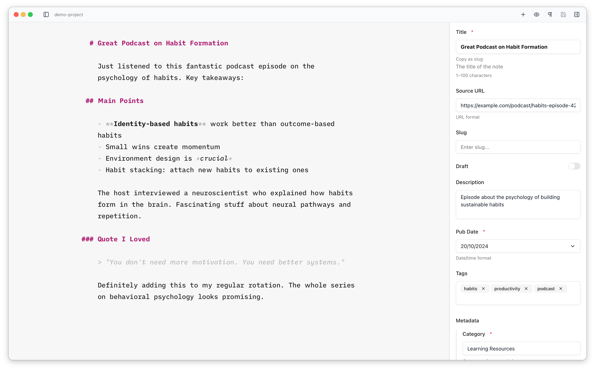

The frontmatter sidebar automatically generates a form based on your Astro content collection schema and the frontmatter present in the file. This means you get appropriate input types and a clean editing experience without any manual configuration.



## How Schema Parsing Works

To build the form, Astro Editor needs to understand your collection's schema. It reads that schema from two places and combines them.

### 1. The generated JSON schema

When Astro runs [`astro sync`](https://docs.astro.build/en/reference/cli-reference/#astro-sync) (which `astro dev` and `astro build` also do), it writes a JSON schema for each collection into `.astro/collections/`, such as `.astro/collections/blog.schema.json`. This is where Astro Editor gets almost everything the form needs: each field's type, constraints, description and default, and which fields are required. Astro Editor watches this folder, so the form updates whenever the files are written again.

### 2. Your content config, for images and references

A JSON schema can't tell an `image()` field or a `reference()` field from plain text, so Astro Editor also reads your content config to find those two helpers. Everything else comes from the JSON schema.

```ts title="src/content.config.ts" {5,6}
const blog = defineCollection({
  schema: ({ image }) =>
    z.object({
      title: z.string().max(100), // from the JSON schema
      cover: image(), // found in the config: an image picker
      author: reference('authors'), // found in the config: an entry picker
    }),
})
```

See [Field Types](/frontmatter/field-types/) for the control each field gets.

### When there's no JSON schema

If the generated JSON schema is missing or can't be read, Astro Editor only knows the `image()` and `reference()` fields it found in your config, and treats them as optional. Every other field in a file is shown as plain text, without its type, default or required marker. A schema imported from another file, like Starlight's, gives nothing without the JSON schema.

To fix it, run `astro sync` (or start your dev server) in your project. Astro Editor picks up the new schema on its own. The **Schema** section of the collection's page in [Project Settings](/project-settings/#schema) shows exactly what was read, and the top of the page says if the schema is missing or couldn't be read.

## Field Order and Defaults

Fields appear in the sidebar in the order they're defined in your schema, except the title field, which is always shown first.

A new file gets a placeholder title and today's date for its published date. A required switch, date or list gets off, today or an empty list. Other required fields, like text, numbers, choices and images, are left for you to fill in: they're marked required in the panel, and Astro's build names any that are still missing.

The frontmatter is written to your file in the same order it's defined in the schema, with any fields that aren't in the schema written after them, in alphabetical order by field name.

## Fields not in your schema

Frontmatter fields that aren't part of the schema are never discarded. They're still shown in the sidebar — below the schema fields and sorted alphabetically — and they're kept when you save. Because there's no schema to describe them, they're shown as plain text inputs (a list of text values becomes a tag field), rather than as typed controls like date pickers or toggles.
