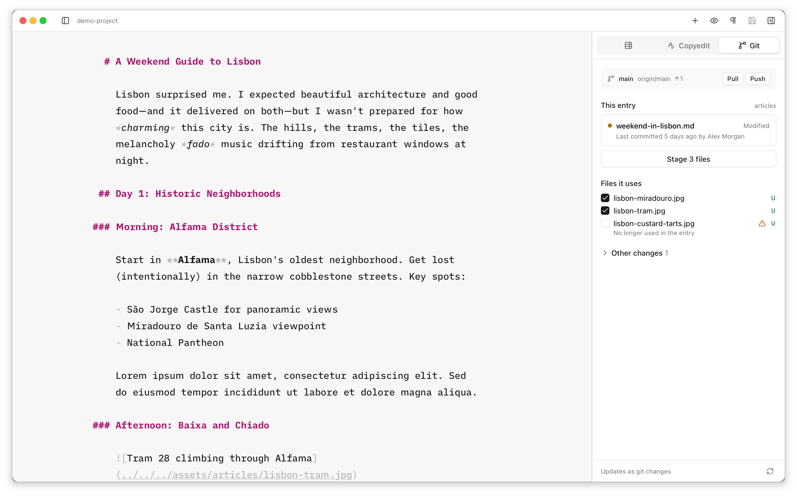
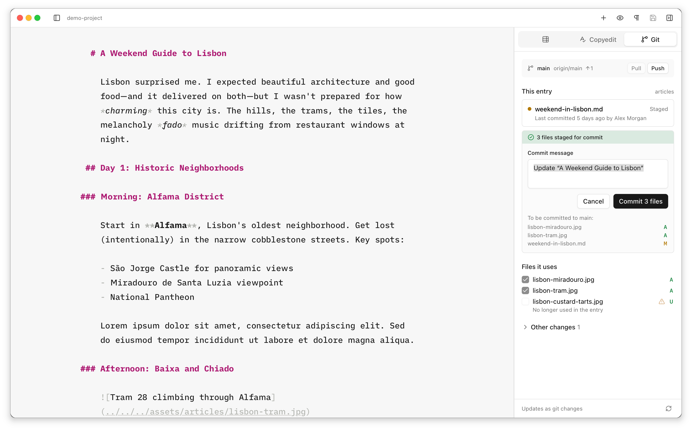
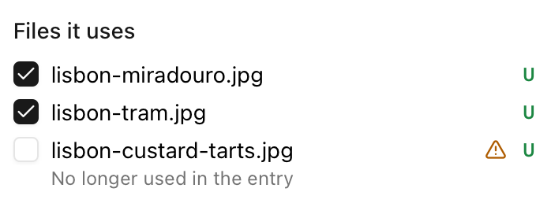
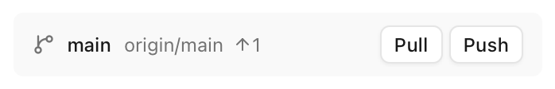

<Aside type="caution" title="This feature is experimental">
The Git tab is newer than the rest of Astro Editor and may have more bugs. If you find one, please [report it](https://github.com/dannysmith/astro-editor/issues).
</Aside>

You've finished a piece of writing and it has a few new images in it. All you want to do is commit those files and push them, but that usually means leaving writer mode for a terminal or code editor and working out which changed files belong to this post.

The **Git tab** does that one job from inside Astro Editor. It's for people who already use git, and it's deliberately small: [branches, merges and conflicts](#when-to-use-another-tool) still belong in a tool built for them.

## Switching It On

<Steps>

1. Open [Project Settings](/project-settings/#git).
2. Turn on **Git panel** in the **Git** section.
3. Open the **Git** tab in the right sidebar, or press <Kbd mac="Cmd+4" windows="Ctrl+4" />.

</Steps>

You need git 2.31 or later, and your project needs to be in a git repository. A site in a folder of a bigger repository, like a docs site in a monorepo, is fine. If something's stopping it from working, Project Settings says what and how to fix it.

It's switched on per project. While it's off, Astro Editor runs no git at all for that project.

## Committing What You've Written

<Steps>

1. **Write.** Astro Editor saves as you go, and the tab keeps up with what's changed.

2. **Check the files.** The entry is included automatically, and the images and other files it uses are ticked under **Files it uses**.

3. **Stage.** Press **Stage**. A card opens with a commit message and exactly what will be committed.

4. **Commit.** The message starts as `Add “Title”` or `Update “Title”`, ready to type over. Press **Commit**, or <kbd>⌘</kbd> <kbd>↩</kbd> on a Mac.

5. **Push.** Press **Push** at the top of the tab.

</Steps>

**Cancel** unstages the files and closes the card. Only one entry can have files staged at a time, since a commit takes everything that's staged. If something was already staged outside Astro Editor, the card lists it too, marked **staged outside AE**, so a commit never includes anything you can't see.

### The Files That Go With an Entry

Astro Editor ticks the changed files your entry refers to: images in its text, image fields in its frontmatter, MDX imports and component props. For an entry at `folder/index.md`, that's everything changed in its folder. Other content files are never ticked, even if the entry links to them.

If you drop in an image and then take it out again, it's listed unticked and marked **No longer used in the entry**, so it doesn't get left behind in your project. The warning sign, or **Delete…** in its right-click menu, moves it to the Trash. If you've turned on [**Permanently delete files**](/preferences/#general), it asks first and then removes it for good. Astro Editor forgets these files when you quit.

Anything else that's changed in your project is under **Other changes**, where you can tick it to include it in the commit.

## Pushing and Pulling

The strip at the top of the tab shows your branch, its upstream, and how many commits there are to push (↑) and pull (↓). Click the counts to see the commits.

**Push** pushes this branch, and only this branch, to where a plain `git push` would.

**Pull** fetches, then brings in new commits, but only when that can be done cleanly. If it can't, it tells you why and changes nothing. A pull is the only time the tab fetches, so the ↓ count is as of the last one. [How the Git Tab Works](/reference/git/#when-pull-refuses) lists each case and what to do.

## When to Use Another Tool

The Git tab is here to solve a problem you run into while you're writing. Branches, merges and conflicts are where getting it wrong can lose work or break a shared repository, and plenty of excellent tools already handle them. So it doesn't:

- Create or switch branches, or do the first push of a new branch
- Discard changes, stash, or make merge commits
- Resolve conflicts
- Sign you in to anything
- Do anything automatically

If git is in the middle of a merge or rebase, you're on a detached HEAD, or files have conflicts, the tab won't commit or push and tells you to finish in your git tool.

Right-click any file in the tab for **Reveal in Finder**, **Open in IDE** and **Copy Path**, or click a content file to open it. The tab updates as git changes, including when you commit from another app. Its refresh button reads git's status again without fetching.

<LinkCard title="How the Git Tab Works" href="/reference/git/" description="Which git it runs, exactly what each button does, and what to do when something goes wrong." />
