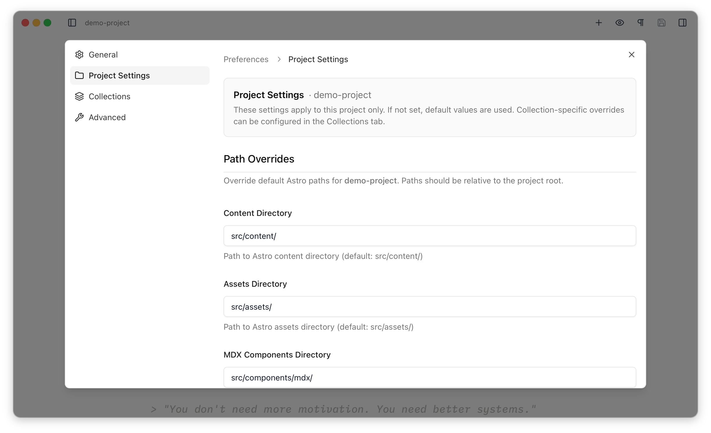
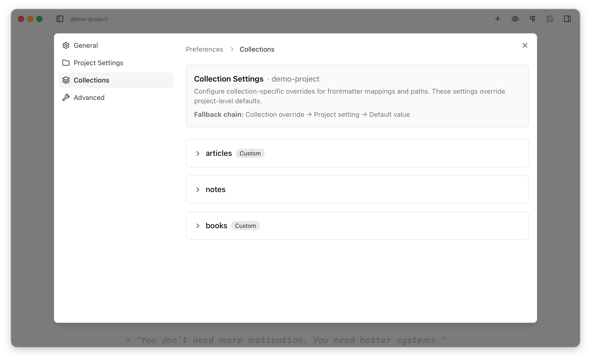

The preferences can be opened with <Kbd mac="Cmd+," windows="Ctrl+," /> or via the app menu. The **General** and **Advanced** panes are always available, while the **Project Settings** and **Collections** panes appear only when a project is open.

## General

Global preferences that apply to every project.

**IDE Command** — the command used to launch your editor for "Open in IDE" (for example `code`, `cursor`, or a full path like `/usr/local/bin/nvim`). See [IDE Integration](/file-management/ide-integration/).

**Theme** — Light, Dark, or System (System follows your operating system).

**Default File Type for New Files** — whether new files are created as Markdown (`.md`) or MDX (`.mdx`). Collections can override it — see [Overrides](/reference/overrides/).

### Appearance

**Heading Color (Light Mode)** / **Heading Color (Dark Mode)** — the colour of Markdown headings in the editor, set separately for each theme, each with a Reset button. See [the editor overview](/editor/overview/).

**Editor Font Size** — the base font size for editor text, in pixels (default 18). The rest of the editor's typography scales from this.

### Editor

**Auto Save Delay** — how long after you stop typing before changes are written to disk: 1, 2, 5, or 10 seconds (default 2). See [Auto-save](/editor/overview/#auto-save).

## Project Settings

Settings for the whole of the currently-open project. [Overrides](/reference/overrides/) lists the defaults for each.

### Path Overrides

**Content Directory** — where collections are looked for when Astro Editor can't read their loader, and whose folders become collections when there's no content config (default `src/content`).

**Assets Directory** — where dragged or inserted images are copied (default `src/assets`). Collections can override it.

**MDX Components Directory** — where the [component builder](/editor/mdx-components/) looks for components (default `src/components/mdx`).

**Use Absolute Paths for Images** — off by default, so inserted image paths are relative to the current file. Collections can override it. See [Images & Files](/editor/images-and-files/).

### Experimental

**Add Imports for MDX Components** — off by default. When it's on, the [component builder](/editor/mdx-components/#adding-imports) also adds the import a component needs. Leave it off if your site imports components automatically. If `package.json` lists `astro-auto-import`, the setting reminds you.

## Collections

Astro Editor reads each collection's folder and file pattern from its loader, and its title, date, description and draft fields from its schema. Pick a collection to see what it's using, and change a setting only when that isn't right. Each setting shows what it uses when it's left empty.

### Files

**Folder** — where the collection's files are, relative to the project root. Leave it empty to use the loader's.

**Files the Pattern Leaves Out** — hide the Markdown files in the folder that the loader's pattern excludes (the default), or show them dimmed. Showing them suits drafts kept out of the site as `_draft.md`.

**Default File Type for New Files** — Markdown or MDX, or the global default. When the pattern only includes one type, new files always use it.

### Images

**Assets Directory** and **Use Absolute Paths for Images** — override the project's image settings for this collection.

### Frontmatter Mappings

Tell Astro Editor which frontmatter field to treat as each [special field](/frontmatter/special-fields/) in this collection, when the one it detects isn't right.

**Published Date Field** — the date field used to order the file list (must be a date field).

**Title Field** — the field shown as the title and given the special panel treatment (must be a string).

**Description Field** — the field rendered as a tall, multi-line text area (must be a string).

**Draft Field** — the boolean field that drives the draft badge and filter.

### Content Links

**Link URL Pattern** — a template for links the [Content Finder](/editor/links/#internal-links) inserts, using `{slug}` (for example `/blog/{slug}`). When left empty, links use a relative file path instead. See [Overrides](/reference/overrides/).

## Advanced

Diagnostics and maintenance rather than day-to-day settings. The tab shows the application and preferences versions, and offers two actions:

- **Open Preferences Folder** — reveal where your settings are stored on disk (see [Advanced Preferences](/reference/advanced-preferences/)).
- **Reset All Preferences** — delete every stored setting and restart the app. This is destructive and can't be undone, but it's useful if your settings ever become corrupted. See [Troubleshooting](/reference/troubleshooting/).
