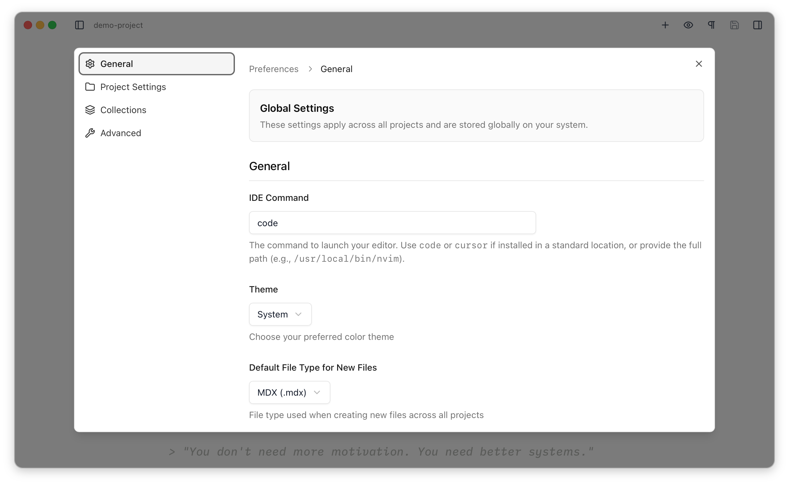

The preferences can be opened with <Kbd mac="Cmd+," windows="Ctrl+," /> or via the app menu. They apply to every project. Settings for one project and its collections are in [Project Settings](/project-settings/), which the Preferences sidebar links to when a project is open.

## General

Global preferences that apply to every project.

**IDE Command** — the command used to launch your editor for "Open in IDE" (for example `code`, `cursor`, or a full path like `/usr/local/bin/nvim`). See [IDE Integration](/file-management/ide-integration/).

**Theme** — Light, Dark, or System (System follows your operating system).

**Default File Type for New Files** — whether new files are created as Markdown (`.md`) or MDX (`.mdx`). Collections can override it — see [Overrides](/reference/overrides/).

### Appearance

**Heading Color (Light Mode)** / **Heading Color (Dark Mode)** — the colour of Markdown headings in the editor, set separately for each theme, each with a Reset button. See [the editor overview](/editor/overview/).

**Editor Font Size** — the base font size for editor text, in pixels (default 18). The rest of the editor's typography scales from this.

### Editor

**Auto Save Delay** — how long after you stop typing before changes are written to disk: 1, 2, 5, or 10 seconds (default 2). See [Auto-save](/editor/overview/#auto-save).

## Advanced

Diagnostics and maintenance rather than day-to-day settings. The tab shows the application and preferences versions, and offers two actions:

- **Open Preferences Folder** — reveal where your settings are stored on disk (see [Advanced Preferences](/reference/advanced-preferences/)).
- **Reset All Preferences** — delete every stored setting and restart the app. This is destructive and can't be undone, but it's useful if your settings ever become corrupted. See [Troubleshooting](/reference/troubleshooting/).
