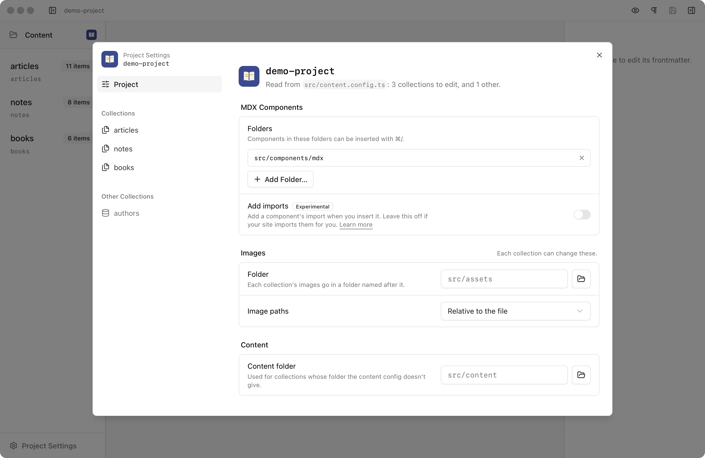
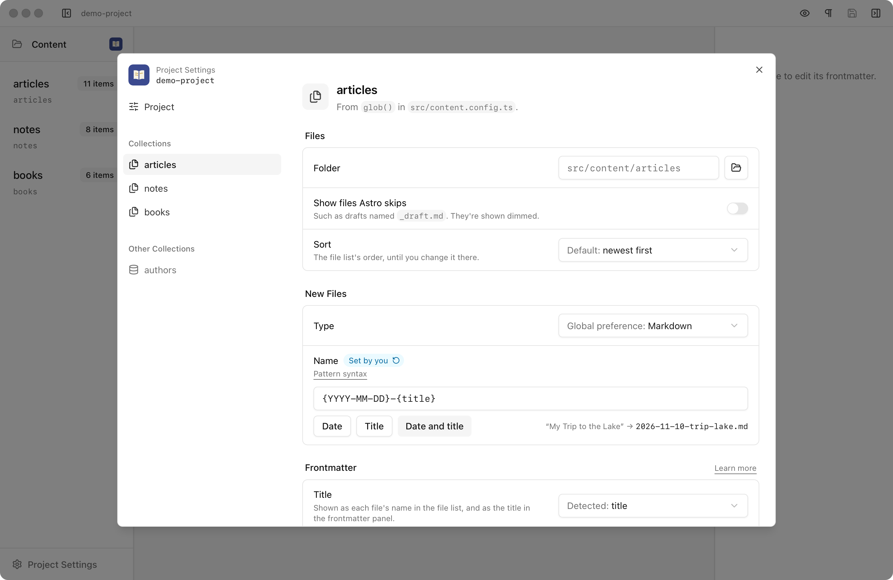
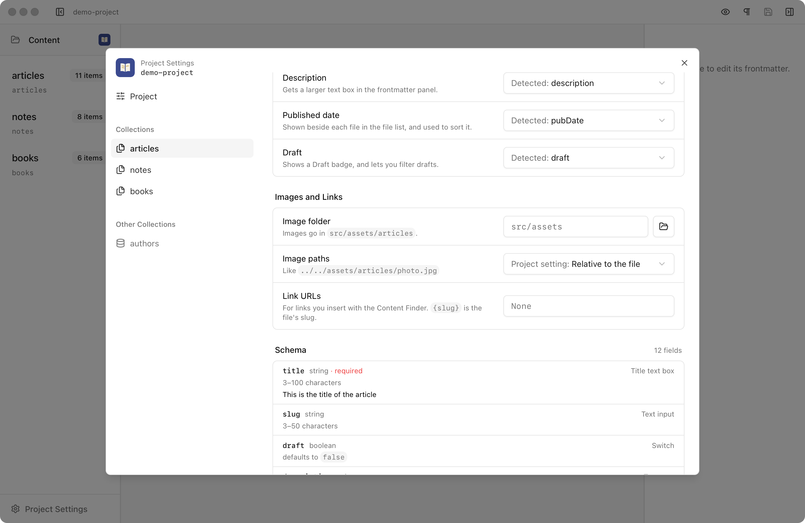

Astro Editor reads your project rather than asking you about it: each collection's folder and file pattern come from its loader in the content config, and its title, date, description and draft fields are detected in its schema. Project Settings shows what it found, and is where you correct it when it isn't right.

Open it with `File > Project Settings…`, or with the project's icon in the file list: its favicon, or the first letter of its folder name. It shows the open project's settings only.

## How settings work

There are three kinds of setting:

- **What Astro Editor reads from your project:** its collections, their folders and file patterns, their schemas, and the fields they use for titles, dates, descriptions and drafts. These come from your content config and the schemas Astro generates, and are read again whenever they change. They're never stored.
- **What you set here:** corrections to what was read, and choices like how new files are named. They're stored for each project on this computer, in Astro Editor's own data rather than in your project, so they aren't in your repository. Another computer, or someone else working on the site, doesn't get them.
- **[Preferences](/preferences/):** about you rather than the project, like the theme. They apply to every project.

Settings from Astro Editor 1.0 aren't carried over. The first time a later version opens a project, its old settings file is set aside, so anything you changed in 1.0 needs setting again here. Most projects don't need any settings, since their folders and fields are read from the project itself.

The sidebar lists the project, then its collections. Any with a problem have a warning or error icon, which the file list shows too. Under **Other Collections** are the ones Astro Editor doesn't edit: data collections (JSON and YAML), and collections whose loader probably doesn't read files, such as one that fetches its entries from an API.

## Where each value comes from

Most settings start out with a value Astro Editor found or a default, and you only change the ones that are wrong. A setting you've changed is marked **Set by you**, with a button that resets it.

Where a value came from somewhere else, the first choice in its menu says so:

| First choice | Meaning |
| --- | --- |
| **Detected: `title`** | A field of the right name and type in the collection's schema. |
| **Found in files: `title`** | Without a generated schema, the usual field name that the collection's files use. |
| **None** | Nothing was found. The line under the setting says what it's for, so you can see what you won't get. This is normal for **Draft** and **Description**, which plenty of sites don't have. |
| **Project setting** | The value set on the project page. |
| **Global preference** | Your [Preferences](/preferences/). |
| **Default** | Astro Editor's default, such as sorting newest first. |

Picking the first choice is the same as resetting. A setting with no source shown, like a folder, is using the default. What every setting uses when you haven't set it is listed in the [Settings Reference](/reference/settings/).

Only set a value when the one Astro Editor found is wrong. A detected value follows your config: rename the field in your schema and Astro Editor picks up the new name. A value you set stays as it is, even if your config changes, until you reset it.

## The project

The project page says which content config was read and how many collections it has. It can show two warnings:

- **No content config, or none Astro Editor could read.** It says which, and why. Each folder in the content folder is then listed as a collection, without a schema, which keeps Astro Editor useful for plain Markdown folders. If your content is somewhere else, change the [content folder](#content). If the config couldn't be read, the warning includes the error.
- **No collections to edit.** Every collection in the config is a data collection (JSON or YAML), which Astro Editor doesn't edit.

### MDX components

**Folders**: the folders the [component builder](/editor/mdx-components/) offers components from, including their subfolders. The default is `src/components/mdx`. Add as many as your site uses, such as `src/components/mdx` and `src/components/docs`.

**Add imports** (experimental): off by default. When it's on, the component builder also [adds the import](/editor/mdx-components/#adding-imports) a component needs. Leave it off if your site imports components for you. If `package.json` lists `astro-auto-import`, the setting warns you.

### Images

These are the defaults for every collection, and each collection can change them.

**Folder**: where dragged or inserted images are copied, in a folder named after the collection. The default is `src/assets`, so a blog post's images go in `src/assets/blog`.

**Image paths**: **Relative to the file** (the default, as Astro writes them) or **From the project root**, such as `/src/assets/blog/photo.jpg`. See [Images & Files](/editor/images-and-files/).

### Content

**Content folder**: where collections are looked for when the content config doesn't say where they are, and whose folders become collections when there's no content config. The default is `src/content`.

### Removed collections

If you have settings saved for collections your content config no longer has, they're listed at the bottom of the page with a **Clear** button.

## Collections

The top of a collection's page says where it comes from, such as `glob()` in `src/content.config.ts`. Anything wrong is shown under it. An error means the collection can't be used properly. A warning means it works, but Astro Editor has less to go on.

| Problem | Level | What to do |
| --- | --- | --- |
| Its folder doesn't exist | Error | Use **Choose Folder…** to pick where its files are. |
| Its folder is outside the project | Error | Astro Editor only edits files inside the project. Use **Choose Folder…** to pick a folder inside it. |
| Its generated schema couldn't be read | Error | Run `astro sync` in your project. Until then, only its `image()` and `reference()` fields are known. |
| Astro hasn't generated its schema | Warning | Run `astro sync` (or `astro dev`) in your project. Until then, the frontmatter panel doesn't know its fields' types, defaults or which are required. Astro Editor picks up the schema as soon as it's written. |
| Its loader's `base` couldn't be read | Warning | Its folder is assumed to be the one named after it in the content folder. If that's wrong, use **Choose Folder…**. |
| Its loader's `pattern` couldn't be read | Warning | Every Markdown file in its folder not starting with `_` is listed. If the wrong files are listed, write the pattern in a simpler form, such as `**/*.{md,mdx}` rather than `**/*.@(md\|mdx)`. |

A loader's `base` and `pattern` can be plain strings, or template literals and `+` joining strings defined in the config, like `` `./${BLOG_PATH}` ``. One built from anything else, like a function call, can't be read.

A collection without a schema isn't a problem, but its page says so at the top, since its fields can only be edited as plain text.

If Astro Editor can't read a collection's loader, or its definition (such as one imported from another file), it looks for a folder named after the collection in the content folder. When there is one, it uses that, and the page says so. When there isn't, the collection is listed under Other Collections.

### Files

**Folder**: the folder you browse in the file list, read from the loader. Type a path relative to the project root, or choose one with the folder button. Set it only if the collection's files aren't where the loader says.

**Show files Astro skips**: off by default, so Markdown files in the folder that the loader's pattern leaves out aren't shown. Turn it on to see them dimmed, which suits drafts kept out of the site as `_draft.md`. Dimmed files open and edit like any other, but they aren't entries, so the [Content Finder](/editor/links/#internal-links) and reference pickers don't offer them.

**Sort**: how the file list is sorted until you [change it there](/file-management/drafts-filtering-and-sorting/#sorting). By default, files are sorted by published date, newest first.

### New files

**Type**: Markdown or MDX, or the [global preference](/preferences/#general). When the pattern only includes one type, new files always use it, and that's shown instead.

### File names

**Name**: how new files are named, as a pattern. **Date**, **Title** and **Date and title** fill in the common ones, and the example beside them shows what the pattern gives as you type.

- `{title}` is the title as a slug, as **Copy as slug** makes it: lowercase, without accents, punctuation or small words like "the", so "My Trip to the Lake" becomes `trip-lake`. A new file has no title yet, so it's named without one, then renamed once when you first write its title and leave the field.
- Any other placeholder is a date, written with `YYYY`, `YY`, `MM`, `M`, `DD` and `D`, such as `{YYYY-MM-DD}` or `{YYYY}`. It's the file's published date, or today.
- Everything else is kept as written, so `{YYYY}-{MM}-{DD}-{title}` and `notes-{title}` work too.

The default, `{YYYY-MM-DD}`, names files with today's date. If the name is taken, `-1`, `-2`… is added. Files named `index` are never renamed.

To rename any file by the pattern, use the **Rename File from Pattern** command. When the published date changes, a **Rename file to match** link below it changes just the date in the file's name.

### Frontmatter

Which frontmatter field to treat as each [special field](/frontmatter/special-fields/), when the one Astro Editor detects isn't right. Each one lists the schema's fields of the right type, or without a generated schema, the fields the collection's files have.

**Title**: a string field, shown as each file's name in the file list and as the large title at the top of the frontmatter panel.

**Description**: a string field, given a larger text box in the frontmatter panel.

**Published date**: the date field shown beside each file in the file list and used to sort it.

**Draft**: the true/false field that shows a **Draft** badge and lets you filter drafts.

### Images and links

**Image folder** and **Image paths**: change the project's image settings for this collection.

**Link URLs**: a template for links the [Content Finder](/editor/links/#internal-links) inserts, using `{slug}`, such as `/blog/{slug}`. When it's empty, links use a relative file path.

### Schema

Each field as Astro Editor read it: its name, type, whether it's required, its constraints, default and description, and how the frontmatter panel shows it, such as a date picker or an image picker. Fields the panel can't give a proper control, like objects without fixed fields, say **Edited as JSON**.

Without a generated schema, Astro Editor only knows the fields that use `image()` or `reference()` in your config, if any. The panel still shows each file's other fields, as text, without types, defaults or required markers. Run `astro sync` (or `astro dev`) in your project to generate the schema.

## Other collections

A data collection's page says where it's defined and shows its schema. If you've set an IDE in [Preferences](/preferences/), **Open in IDE** opens its files there.

A collection whose loader probably doesn't read files, like one that fetches from an API, shows its schema and a **Folder** setting. A loader written in the config itself is described as "From a loader written in `src/content.config.ts`, which probably doesn't read files." So does one whose definition couldn't be read and whose folder wasn't found. If its entries are Markdown files in your project after all, choose their folder and it moves into the file list.

## Opening a project for the first time

The first time you open a project, if Astro Editor couldn't read everything in it, a message says so, with a **Review** button that opens Project Settings. The same happens the first time a project with Astro Editor 1.0 settings opens. If everything was read, nothing appears.
