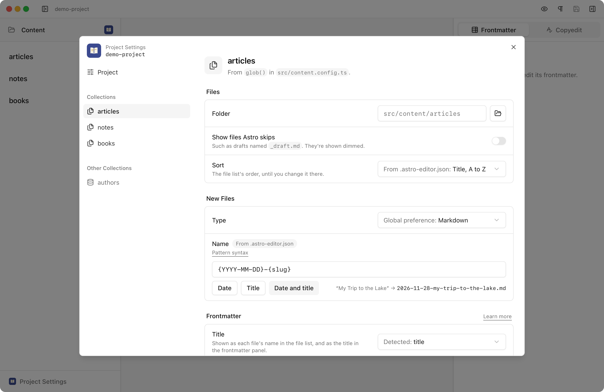

In projects where several people use Astro Editor, it can occasionally help to keep some project settings in the project itself, alongside your code. Put them in an `.astro-editor.json` file at the project's root and commit it, and everyone who opens the project in Astro Editor starts with them.

You probably don't need one. Astro Editor reads your folders, file patterns and fields from your content config and schemas, so most projects need few settings, and if you're the only person editing a site, [Project Settings](/project-settings/) is the place for them. If you do add a file, keep it small: only put in what Astro Editor can't work out for itself, like how new files are named. Don't set values it already gets right, because a value it reads follows your project when it changes, and one in this file stays as it is until someone edits it.

When a project has one, Project Settings says so at the top of the project page:


## How it fits with your settings

Your own settings come first, then the file, then what Astro Editor reads from your project. So anyone can change a setting from the file for themselves in Project Settings, without touching the file, and resetting it goes back to the file's value. For the image settings, a collection's value comes before the project's, wherever each is set.

Values from the file are labelled **From .astro-editor.json**:



Astro Editor only reads the file, and never writes to it. Changes show as soon as you save it. If it can't use the file, because it isn't valid JSON or a value is the wrong type, the project page shows the error and the file is ignored.

## Writing the file

The file uses the same format as the project settings Astro Editor [stores on your computer](/reference/advanced-preferences/#whats-in-there), without their `version` and `path`. So the easiest way to write one is to copy yours:

<Steps>

1. Set what you need in Project Settings.
2. In [Preferences](/preferences/), choose **Open Preferences Folder** in the **Advanced** tab.
3. In `preferences/projects/`, open the file named after your project's folder.
4. Copy its `project` and `collections` sections into `.astro-editor.json` at your project's root, and take out anything only you need.

</Steps>

Add the `$schema` line from the example below. It lets code editors like VS Code suggest settings and point out mistakes as you type.

## Settings

The `project` section and the `articles` collection below set everything, to show every setting. A real file should be much smaller, like `books`, which only gives the draft field Astro Editor couldn't detect.

```json title=".astro-editor.json"
{
  "$schema": "https://astroeditor.danny.is/astro-editor-config.schema.json",
  "project": {
    "mdxComponentsDirectories": ["src/components/mdx", "src/components/docs"],
    "addComponentImports": false,
    "assetsDirectory": "src/assets",
    "useAbsoluteAssetPaths": true,
    "contentDirectory": "src/content",
    "reorderFrontmatter": true,
    "gitPanel": false
  },
  "collections": {
    "articles": {
      "folder": "src/content/articles",
      "skippedFiles": "dim",
      "defaultSort": { "mode": "date-pubDate", "direction": "desc" },
      "defaultFileType": "mdx",
      "fileNamePattern": "{YYYY-MM-DD}-{slug}",
      "titleField": "title",
      "descriptionField": "summary",
      "publishedDateField": "pubDate",
      "draftField": "draft",
      "assetsDirectory": "src/images",
      "useAbsoluteAssetPaths": false,
      "urlPattern": "/articles/{slug}"
    },
    "books": {
      "draftField": "draftBookReview"
    }
  }
}
```

Each key is a setting in [Project Settings](/project-settings/), in the same order, and takes what you'd type or choose there. Paths are relative to the project root, and collections go by their names in your content config. Both sections are optional, and so is every setting. What each one does, and what's used when nobody sets it, is in the [Settings Reference](/reference/settings/).

A few take particular values:

- **`skippedFiles`** is `"hide"`, or `"dim"` to show the files dimmed, like turning on **Show files Astro skips**.
- **`useAbsoluteAssetPaths`** is `true` for paths from the project root, and `false` for paths relative to the file.
- **`defaultFileType`** is `"md"` or `"mdx"`.
- **`defaultSort`** has a `direction` of `"asc"` or `"desc"`, and a `mode` of `title`, `filename`, `modified`, `order` (a number field named `order`), or `date-` and a date field's name, like `date-pubDate`.
