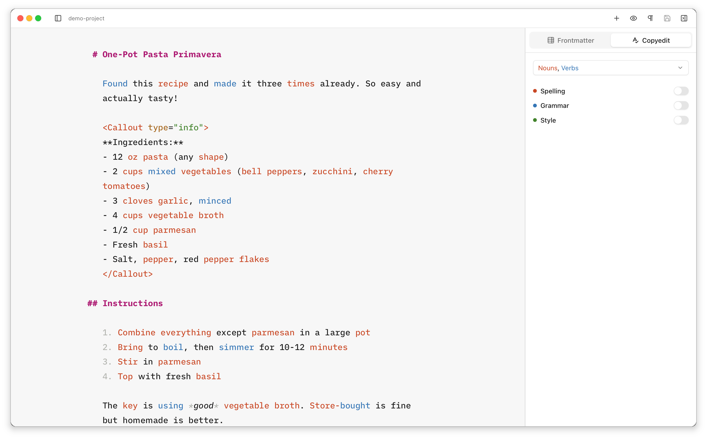
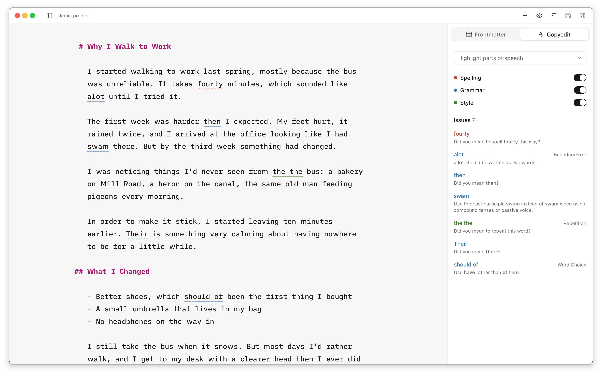
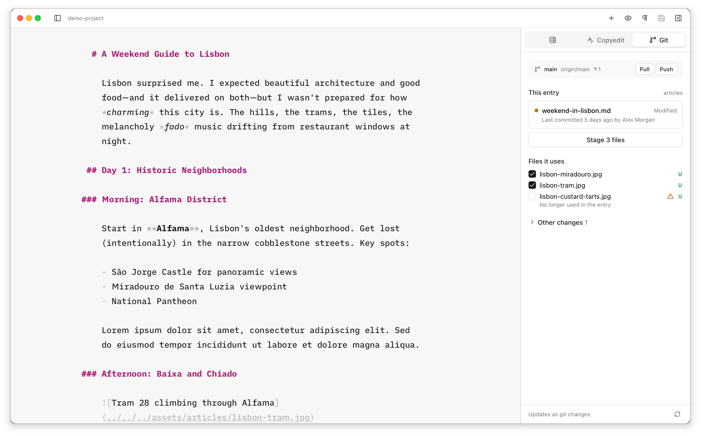
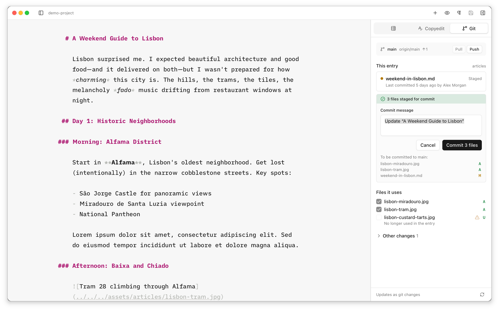

import releaseVideo from '@assets/release-1.2.0.mp4'
import releasePoster from '@assets/release-1.2.0-poster.jpg'

<video src={releaseVideo} poster={releasePoster.src} controls playsinline preload="metadata" width="1920" height="1080" style="width: 100%; height: auto;"></video>

Astro Editor now helps once the first draft is done. A new Copyedit panel checks your spelling, grammar and style, a Git tab commits and pushes what you've written, and editing frontmatter now changes only the field you edited.

**If you're upgrading from 1.1:**

- **Deleting a file now moves it to the Trash**, without asking, as Finder does. To delete files for good, after a confirmation, turn on **Permanently delete files** in [Preferences](https://astroeditor.danny.is/preferences/#general). (#392)
- **`{title}` in file name patterns now uses every word of the title.** "My Trip to the Lake" used to give `trip-lake`, and now gives `my-trip-to-the-lake`. Your existing files keep their names unless you rename them from the pattern. To keep the shorter style, change `{title}` to `{shortSlug}` in [Project Settings](https://astroeditor.danny.is/project-settings/#file-names).
- **Frontmatter fields now stay in the order you wrote them.** Editing a file used to sort them into schema order. To keep doing that, turn on **Reorder frontmatter** in [Project Settings](https://astroeditor.danny.is/project-settings/#content).

### Copyedit panel

The right sidebar now has tabs, with **Frontmatter** on <kbd>⌘2</kbd> and the new **Copyedit** panel on <kbd>⌘3</kbd>. Each shortcut opens its tab, or closes the sidebar if that tab is already showing. The part-of-speech highlights now have a dropdown at the top of the panel, as well as their commands in the palette. See [Copyediting, Spelling & Grammar](https://astroeditor.danny.is/editor/copyediting/). (#381, #383)

### Spelling, grammar and style

Switch on **Spelling**, **Grammar** and **Style** in the Copyedit panel, and issues are underlined in the editor and listed in the panel. Hover an underline or click an issue to apply a suggested fix, add the word to your dictionary, or ignore it.

The checks use [Harper](https://writewithharper.com), which runs entirely on your computer, so nothing you write is sent anywhere. They only check English, and you can choose American, British, Canadian, Australian or Indian English in [Preferences](https://astroeditor.danny.is/preferences/#copyedit). They skip your frontmatter, code, URLs and component tags, and stay quiet about names, acronyms and house-style choices. See [Spelling, Grammar and Style](https://astroeditor.danny.is/editor/copyediting/#spelling-grammar-and-style). (#265)

### Git tab (experimental)

For writers who already use git, the Git tab commits the entry you're working on, with the images and other files it uses, and pushes it without you leaving Astro Editor. It ticks the changed files your entry refers to, and points out images you added and then took out so they don't get left behind. It runs your own `git`, so your credentials, hooks and signing work as they do in your terminal. Pull only brings in new commits when it can do so cleanly. Branches, merges and conflicts are left to your git tool.

It's off by default. Turn on **Git panel** in [Project Settings](https://astroeditor.danny.is/project-settings/#git), then open the tab with <kbd>⌘4</kbd>. It needs git 2.31 or later, and while it's off, Astro Editor runs no git for that project. See [Git](https://astroeditor.danny.is/git/) and [How the Git Tab Works](https://astroeditor.danny.is/reference/git/). (#391)

### Frontmatter, read like Astro and edited in place

Editing a field now changes only that field. Other fields keep their text and comments, the edited field keeps its quotes, list style and trailing comment, and a new field goes where your schema puts it. Before, one edit rewrote the whole block. (#370)

Frontmatter is also read the way Astro reads it, with a YAML parser set up to match Astro's. This was checked with more than 12,000 edits to 1,900 files from real Astro sites, each read back with Astro's own parser.

Frontmatter that can't be read, like invalid YAML or a field written twice, now shows the error and its line number in the frontmatter panel. You can still edit the body, and saving leaves the frontmatter as it was. Before, the file opened blank and typing in it overwrote the file. See [How YAML is Handled](https://astroeditor.danny.is/reference/yaml/). (#388)

### File name patterns

Patterns can now use `{slug}`, `{shortSlug}`, time tokens like `HH`, `mm` and `ss`, `X` for timestamp IDs, and `{index}` or `{index:2}` for numbered files like `01-welcome.md`. Renaming a file from its pattern keeps the time and number already in its name. See [File names](https://astroeditor.danny.is/project-settings/#file-names). (#379)

### Colour themes

A colour theme is a CSS file of colour overrides. Add one to a `themes` folder in the app's data directory and pick it under **Custom colour theme** in Preferences. There are no built-in themes, so this is for people happy to write a little CSS. Headings now follow the text colour until you pick one, so if a theme's headings don't match, click **Reset** next to the heading colours in Preferences. See [Colour themes](https://astroeditor.danny.is/reference/advanced-preferences/#colour-themes). (#197)

### Bug fixes

- **Typing before a file had loaded** – Anything typed before a file finished loading could be saved over it. (#388)
- **Edits during a save** – Text typed while a save was running wasn't auto-saved until you next edited the file.
- **Failed saves** – Each failed save added another error message. There's now one, which updates.
- **Working offline** – Collections and files could get stuck loading while your computer had no internet connection.

### Under the hood

- **Large collections** – File lists and new file names are faster, long scans no longer hold up saves, and saving an edit to the body no longer re-reads the sidebar's folder. (#386)
- **Reading during a save** – Astro Editor no longer reads an entry while it's saving it. Rarely, a save straight after another could load the entry into the editor empty, and the next save would write that back.
- **Telemetry** – Only official release builds send it. Forks, local builds and CI builds never do. (#380)
- Dependency updates.

---

[View on GitHub](https://github.com/dannysmith/astro-editor/releases/tag/v1.2.0)
